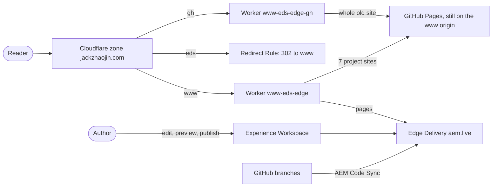

# www-eds

Jack Jin's site, [www.jackzhaojin.com](https://www.jackzhaojin.com), rebuilt on **AEM Edge Delivery Services** with **Experience Workspace (da.live)** authoring. It's the same site with the same design and the same URLs, on a new platform.

The whole site moved from GitHub Pages on 2026-10-25, and every page was checked against the live original with measured gates (pixels, height, content, editability, performance). **www has served it since the cutover on 2026-10-26** (about 15:12 ET). The old GitHub Pages site stays up at gh.jackzhaojin.com for comparison. Release **v1.0.0** marks that state; **v1.0.1** brought GA4 back, **v1.0.2** gives browsers a 10-minute page cache, **v1.1.0** adds listing pages generated from the writing and talks indexes, **v1.1.1** gives every talk and portfolio project its own page, with the three hubs generated from their indexes at the edge, **v1.1.2** adds each page's Related list, **v1.1.3** lets a static page's section run the full content width (section style `wide`), **v1.1.4** gives talk pages their own template, in the project pages' design, and **v1.1.5** loads the YouTube player after the page instead of with it, keeps the `.plain.html` fragments out of search, and adds YouTube and Credly to the generated Person, **v1.1.6** lets the edge Worker serve www from the [www-archive](https://github.com/jackzhaojin/www-archive) snapshot if Adobe can't (`ARCHIVE_ORIGIN`, unset), and **v1.2.0** gives every portfolio project page an animated scene of how the project works (the Scene block, 11 engines). Releases are for code only: content changes are pushed without a version (AGENTS.md).

## Where it runs

| Host | What it serves | Search |
|---|---|---|
| [www.jackzhaojin.com](https://www.jackzhaojin.com) | this site, through the `edge/` Worker (`www-eds-edge`); the 7 project sites under it pass through to GitHub Pages | indexed |
| eds.jackzhaojin.com | a 302 to www, path and query kept (a Cloudflare Redirect Rule since 2026-10-27; the staging Worker behind it gets no traffic) | |
| [gh.jackzhaojin.com](https://gh.jackzhaojin.com) | the old GitHub Pages site, through the `edge/` Worker, kept for comparison | noindex |
| [archive.jackzhaojin.com](https://archive.jackzhaojin.com) | the [www-archive](https://github.com/jackzhaojin/www-archive) snapshot of www as served (Worker `www-archive`), the record of what was published and the standby if Adobe can't serve the site | noindex |
| [main--www-eds--jackzhaojin.aem.live](https://main--www-eds--jackzhaojin.aem.live/) | the Edge Delivery origin (`.aem.page` for preview) | noindex |
| [da.live/#/jackzhaojin/www-eds](https://da.live/#/jackzhaojin/www-eds) | the authoring side: Experience Workspace documents | |



GitHub Pages wasn't moved at the cutover: jackzhaojin.github.io keeps its `CNAME` of www, so GitHub still answers at the zone's origin. The www Worker passes the project sites through to it, and gh mirrors the old site from it. Rollback is one dashboard step: remove the www route. What's left (push invalidation, GA4, a few old URLs that now 404): [ai-docs/2026-10-26-cutover/](ai-docs/2026-10-26-cutover/README.md).

## What was done on 2026-10-25

**Every page, migrated and proven.**
- All 35 sitemap URLs are live at their original paths, plus `/404.html`, the design system site `/design-systems/v3/` (noindex) and the root files (Google and Bing verification, `llms.txt`, favicon).
- Each page was gated against the live GitHub Pages page at 1440 and 360 wide. The gates use stardust's replica instruments: stitched pixel diff with a band breakdown, height delta, content diff, chrome parity, and clip and overflow probes.
- The final sweep passes 34 of 34 at both widths. The 35th page, the article about this build, was published during the evening and gated on its own (1.05% and 2.45%, -3px).

| Check | Result |
|---|---|
| Pixel diff, home | 0.24% at 1440, 1.11% at 360, height delta 0 |
| Pixel diff, explainer-heavy article | 0.05% at 1440, 0.84% at 360, height delta 0 |
| Content diff | 0 looks-same red and 0 nothing-lost yellow on every page (two register exceptions, R11 and R13) |
| Mobile Lighthouse performance | 100 on every page type (the source scored 98 on home, 93 on the article) |
| Editing in Experience Workspace | every authored text clickable: 0 dead and 0 duplicated on every page |
| Anchors | 301 of 301 linked fragments resolve after decoration |
| Dark mode and contrast | the stored Dark theme swept on every page; v3's contrast eval passes on all 36 pages in Light, Dark and System |
| SEO parity with www | the same 35 sitemap URLs; titles, descriptions, canonicals, Open Graph, Twitter, article tags and JSON-LD match on all 35 pages (only the `og:image` sizes differ, on three articles whose social image EDS resizes) |

**What it took.** 41 blocks, 5 templates, an explainer core with 41 engines and 43 importer engines, 40 Experience Workspace documents, and 164 commits in one day. A main Claude Code session built the shared pieces first. Seven parallel streams (listings, portfolio, design system, four article batches) then each ran in its own git worktree.

The day's full record is in [ai-docs/2026-10-25-initial-buildout-2-goals/](ai-docs/2026-10-25-initial-buildout-2-goals/): prompts, process, decisions, incidents, numbers and what's left.

## Releases

Each prompt of the build is an Edge Delivery environment, on the commit it ended at. Edge Delivery names a branch's host by lowercasing it and turning every character that isn't a letter or digit into a hyphen, so the branch `release/0.1` is served at `release-0-1--www-eds--jackzhaojin.aem.live`. A branch changes only the code; the content is the same on every branch.

| Release | Commit | What it is | Environment |
|---|---|---|---|
| [`release/0.1`](https://github.com/jackzhaojin/www-eds/tree/release/0.1) | [`4575a93`](https://github.com/jackzhaojin/www-eds/commit/4575a936f7d7175dcf8403079f4eecf7bc5cca30) | prompt 1: the foundation, home and the article archetype, 11:15 ET | [release-0-1--www-eds--jackzhaojin.aem.live](https://release-0-1--www-eds--jackzhaojin.aem.live/) |
| [`release/0.2`](https://github.com/jackzhaojin/www-eds/tree/release/0.2) | [`f02e0e7`](https://github.com/jackzhaojin/www-eds/commit/f02e0e785461302492bca9474d97e5b93cabbfe5) | prompt 2: all 34 sitemap pages passing, 16:05 ET | [release-0-2--www-eds--jackzhaojin.aem.live](https://release-0-2--www-eds--jackzhaojin.aem.live/) |
| [`release/0.3`](https://github.com/jackzhaojin/www-eds/tree/release/0.3) | the day's last commit | the end of the day: 35 pages, SEO config, the eds and gh hosts, these docs | [release-0-3--www-eds--jackzhaojin.aem.live](https://release-0-3--www-eds--jackzhaojin.aem.live/) |
| [`v1.0.0`](https://github.com/jackzhaojin/www-eds/releases/tag/v1.0.0), branch [`release/1-0-0`](https://github.com/jackzhaojin/www-eds/tree/release/1-0-0) | the tagged commit | the cutover: www served from here, content in git, validated against gh | [www.jackzhaojin.com](https://www.jackzhaojin.com), and [release-1-0-0--www-eds--jackzhaojin.aem.live](https://release-1-0-0--www-eds--jackzhaojin.aem.live/) |
| [`v1.0.1`](https://github.com/jackzhaojin/www-eds/releases/tag/v1.0.1), branch [`release/1-0-1`](https://github.com/jackzhaojin/www-eds/tree/release/1-0-1) | the tagged commit | GA4 per decision 9 (on www only, Global Privacy Control declines) | [www.jackzhaojin.com](https://www.jackzhaojin.com), and [release-1-0-1--www-eds--jackzhaojin.aem.live](https://release-1-0-1--www-eds--jackzhaojin.aem.live/) |
| [`v1.0.2`](https://github.com/jackzhaojin/www-eds/releases/tag/v1.0.2), branch [`release/1-0-2`](https://github.com/jackzhaojin/www-eds/tree/release/1-0-2) | the tagged commit | the edge Worker gives browsers 10 minutes for pages, as GitHub Pages did | [www.jackzhaojin.com](https://www.jackzhaojin.com) |
| [`v1.1.0`](https://github.com/jackzhaojin/www-eds/releases/tag/v1.1.0), branch [`release/1-1-0`](https://github.com/jackzhaojin/www-eds/tree/release/1-1-0) | the tagged commit | listing pages generated from `/writing-index.json` and `/talks-index.json`: authored as one block, rows and JSON-LD rendered at the edge (Worker not yet deployed) and in the browser (PR 2) | [www.jackzhaojin.com](https://www.jackzhaojin.com), and [release-1-1-0--www-eds--jackzhaojin.aem.live](https://release-1-1-0--www-eds--jackzhaojin.aem.live/) |
| [`v1.1.1`](https://github.com/jackzhaojin/www-eds/releases/tag/v1.1.1), branch [`release/1-1-1`](https://github.com/jackzhaojin/www-eds/tree/release/1-1-1) | the tagged commit | one page per talk (`/talks/<id>/`) and per project (`/portfolio/<slug>/`), the writing, talks and portfolio hubs generated from their indexes by the edge Worker, generated JSON-LD for talk and project pages, the DA block library | [www.jackzhaojin.com](https://www.jackzhaojin.com), and [release-1-1-1--www-eds--jackzhaojin.aem.live](https://release-1-1-1--www-eds--jackzhaojin.aem.live/) |
| [`v1.1.2`](https://github.com/jackzhaojin/www-eds/releases/tag/v1.1.2), branch [`release/1-1-2`](https://github.com/jackzhaojin/www-eds/tree/release/1-1-2) | the tagged commit | Related lists on talk and project pages: the articles that link to each, generated from the writing index at the edge and in the browser | [www.jackzhaojin.com](https://www.jackzhaojin.com), and [release-1-1-2--www-eds--jackzhaojin.aem.live](https://release-1-1-2--www-eds--jackzhaojin.aem.live/) |
| [`v1.1.3`](https://github.com/jackzhaojin/www-eds/releases/tag/v1.1.3), branch [`release/1-1-3`](https://github.com/jackzhaojin/www-eds/tree/release/1-1-3) | the tagged commit | section style `wide`: a static page's section runs the full content width (the terms and privacy pages) | [www.jackzhaojin.com](https://www.jackzhaojin.com), and [release-1-1-3--www-eds--jackzhaojin.aem.live](https://release-1-1-3--www-eds--jackzhaojin.aem.live/) |
| [`v1.1.4`](https://github.com/jackzhaojin/www-eds/releases/tag/v1.1.4), branch [`release/1-1-4`](https://github.com/jackzhaojin/www-eds/tree/release/1-1-4) | the tagged commit | the talk template: talk pages in the project pages' design (tinted head, accent subtitle, outlined year, one story box) | [www.jackzhaojin.com](https://www.jackzhaojin.com), and [release-1-1-4--www-eds--jackzhaojin.aem.live](https://release-1-1-4--www-eds--jackzhaojin.aem.live/) |
| [`v1.1.5`](https://github.com/jackzhaojin/www-eds/releases/tag/v1.1.5), branch [`release/1-1-5`](https://github.com/jackzhaojin/www-eds/tree/release/1-1-5) | the tagged commit | SEO and GEO: the video player loads after the page (a poster first), the Worker keeps `.plain.html` fragments noindex on www, YouTube and Credly in the generated Person's `sameAs` | [www.jackzhaojin.com](https://www.jackzhaojin.com), and [release-1-1-5--www-eds--jackzhaojin.aem.live](https://release-1-1-5--www-eds--jackzhaojin.aem.live/) |
| [`v1.1.6`](https://github.com/jackzhaojin/www-eds/releases/tag/v1.1.6), branch [`release/1-1-6`](https://github.com/jackzhaojin/www-eds/tree/release/1-1-6) | the tagged commit | the edge Worker can serve www from the [www-archive](https://github.com/jackzhaojin/www-archive) snapshot if Adobe can't (`ARCHIVE_ORIGIN`, unset) | [www.jackzhaojin.com](https://www.jackzhaojin.com), and [release-1-1-6--www-eds--jackzhaojin.aem.live](https://release-1-1-6--www-eds--jackzhaojin.aem.live/) |
| [`v1.2.0`](https://github.com/jackzhaojin/www-eds/releases/tag/v1.2.0), branch [`release/1-2-0`](https://github.com/jackzhaojin/www-eds/tree/release/1-2-0) | the tagged commit | the Scene block: an animated plate of how each portfolio project works, beside its chapter head, 11 engines | [www.jackzhaojin.com](https://www.jackzhaojin.com), and [release-1-2-0--www-eds--jackzhaojin.aem.live](https://release-1-2-0--www-eds--jackzhaojin.aem.live/) |

On 0.1, pages built in prompt 2 show their blocks undecorated, because their blocks came later. The release branches are frozen: never push to them. How they were made, and the permanent links: [ai-docs releases](ai-docs/2026-10-25-initial-buildout-2-goals/releases.md).

## How it's built

**Same design, recreated.** The design is design system v3, Jack's own, which the GitHub Pages site already used. Its tokens are ported as they are into `styles/styles.css`, with self-hosted Inter, Playfair Display and JetBrains Mono and metric-matched fallback faces. Pages are re-authored as clean Edge Delivery blocks, never DOM copies. The only design changes allowed are entries in the [inconsistency register](stardust/replica/inconsistency-register.md) (R1 to R24, waiting on Jack's review).

**Explainers are content.** The articles carry interactive explainers: labs, switches, comparisons, timelines, a day-in-commits chart. One core block, `explainer (<word>)`, loads `blocks/explainer/engines/<word>.js` and `.css`. The explainer's text and data are block rows an author can edit. The contract is in [stardust/explainer-family.md](stardust/explainer-family.md).

**Editable everywhere.** Blocks move authored elements into role wrappers instead of rebuilding them, so every text stays clickable in Experience Workspace. A probe (`ew-editability-probe --simulate-editor`) checks it on every page.

**Templates.** Metadata `template` loads `templates/<name>/`. There are five: `article`, `listing`, `static`, `portfolio`, `design-docs`.

**The Worker.** `edge/` routes the GitHub Pages project sites (`/adapt-to-2026-demo/`, `/bruce-lava-dash/` and five more) to GitHub Pages. Everything else goes to Edge Delivery through Adobe's Cloudflare worker, vendored with only its handler renamed. Every host but www answers `X-Robots-Tag: noindex, nofollow`, and the Worker answers 404 there for robots.txt and the sitemaps. See [edge/README.md](edge/README.md).

**SEO through the platform.** The production host, robots.txt, query index and sitemap are in the Admin API config service. Redirects and bulk metadata are Experience Workspace sheets, and per-page JSON-LD is page metadata, rendered on the server. All of it is kept as files in [hlx-config/](hlx-config/README.md), with the step-by-step log of how it was applied.

## Repository layout

| Path | What's in it |
|---|---|
| `blocks/` | 42 blocks, including `explainer/` and its 41 engines, and `scene/` with the 11 project scenes |
| `templates/` | the five page templates |
| `styles/`, `fonts/`, `icons/` | v3 tokens and base styles, self-hosted fonts, the v3 icon set |
| `scripts/` | `aem.js` (vendored, never edited), `scripts.js`, the theme control, consent |
| `widgets/` | the writing listing's filter |
| `content/` | example pages in the editor's own form (DA is the content's source of truth since 2026-10-28), plus [its rules](content/README.md) (not served from git) |
| `edge/` | the Cloudflare Worker for eds, gh and, at the cutover, www |
| `hlx-config/` | the site config as files, with the log of how it was applied |
| `stardust/` | the migration's records, instruments and importers; see [stardust/README.md](stardust/README.md) |
| `design-system/v3/` | the design system's own documentation, the source of `/design-systems/v3/` |
| `DESIGN.md`, `DESIGN.json`, `PRODUCT.md` | the design spec, promoted from the captured site |
| `ai-docs/` | the build record |
| `AGENTS.md` | instructions for coding agents (`CLAUDE.md` is a symlink to it) |

Everything that isn't site code is in `.hlxignore`, so Edge Delivery never serves it.

## Working on it

```bash
nvm use            # Node 22
npm i
npx -y @adobe/aem-cli up   # local code with previewed content at localhost:3000
npm run lint
```

The Worker:

```bash
cd edge
npm test                                                  # the Worker tests
node scripts/check-host.mjs --local staging              # the Worker in-process, against the real origins
node scripts/check-host.mjs --base https://www.jackzhaojin.com   # a deployed host
```

**Content** lives in Experience Workspace (DA), the source of truth since 2026-10-28. `content/` keeps example pages that between them use every block, variant, section style and template on the site, for whoever writes the next page. Every change follows [content/README.md](content/README.md), a must-read before editing: pull the page from DA, write it in the form the DA editor keeps, preview it, check it in the browser, publish, then snapshot www into the [www-archive](https://github.com/jackzhaojin/www-archive) repo, the record of what was published (served at archive.jackzhaojin.com, noindex). Pushing goes through the DA Source API with stardust's deploy driver, which keeps a ledger and checks the delivered page before marking it live. The token is the da-auth cache, never printed:

```bash
DA_TOKEN=$(node -e "const t=require(process.env.HOME+'/.aem/da-token.json');if(t.expires_at>Date.now()+60000)process.stdout.write(t.access_token)") \
  node stardust/scripts/deploy/deploy-batch.mjs --org jackzhaojin --repo www-eds --branch main --content content --paths paths.txt
```

**A gate round** compares a page with its source at one width:

```bash
stardust/scripts/replica/gate.sh home https://www.jackzhaojin.com/ \
  https://main--www-eds--jackzhaojin.aem.live/ 1440 check --full --main main --marker "Jack Jin"
```

**A new page** is published here, to EDS; since the cutover, a page added to GitHub Pages no longer shows on www. Write it, or import an HTML draft with the recipe in [whats-left.md, section 5](ai-docs/2026-10-25-initial-buildout-2-goals/whats-left.md), then follow [content/README.md](content/README.md) and sync its SEO ([hlx-config/README.md](hlx-config/README.md)).

## Built with

Claude Code (Opus 5.5) in the Claude desktop app did the work, in auto mode. Jack made the calls and clicked the buttons that change production. The plugins are declared at project scope in `.claude/settings.json`, so a session opened here loads the same skills. No skill files are copied into the repo.

| Plugin | Version | From | Used for |
|---|---|---|---|
| stardust | 0.36.0 | [adobe/skills](https://github.com/adobe/skills) | the method: `replica` (same-design migration), `extract`, `spec`, `dynamics`, `audit`, `qa`, and the gate, deploy and editability scripts |
| aem-edge-delivery-services | 1.0.0 | [adobe/skills](https://github.com/adobe/skills) | the DA sign-in (`da-auth`), boilerplate conventions, docs search |
| impeccable | 4.7.1 | [pbakaus/impeccable](https://github.com/pbakaus/impeccable) | its design hook reviewed every UI file as it was written |
| hlx-admin-api-executor | commit `46e689e` | [jackzhaojin/ai-builder-kit](https://github.com/jackzhaojin/ai-builder-kit) | Jack's own Admin API skill: GET before, SET, GET after, every response kept. It ran the SEO config and the release branches' code sync ([the article about it](https://www.jackzhaojin.com/writing/2026-03-23-eds-hlx-admin-agentic-config/)) |
| marketing-skills | 2.13.5 | [coreyhaines31/marketingskills](https://github.com/coreyhaines31/marketingskills) (MIT) | added 2026-10-26 for SEO and GEO: `seo-audit`, `ai-seo`, `schema` and `site-architecture` framed the [SEO and GEO audit](ai-docs/2026-10-26-seo-geo-audit/README.md). jackzhaojin.github.io had copies from September (ai-seo 2.5.0); the plugin keeps them current |

stardust's scripts are the exception to "no copies": its setup copies them into `stardust/scripts/`, so the gates can be re-run without the plugin.

Used on the day but not checked in:
- **Subagents in git worktrees** (Claude Code) for the seven parallel streams, each with a written brief ([stardust/rollout/brief.md](stardust/rollout/brief.md)).
- **Claude in Chrome**, to fill the Cloudflare DNS forms in Jack's own browser. Jack clicked Save.
- **Playwright** (MCP and `playwright-cli`), **axe-core** and **Lighthouse 12.8.2**, for the extra checks: the dark sweep, axe on both sides, anchors and performance.
- **Adobe's tools:** `da-auth-helper` for the DA token, aem-cli 16.22.14, and Cloudflare's **wrangler** for the Worker deploys.
- **The Claude desktop app's built-in browser**, for checking the release environments.
- **Skills outside the repo:** Jack's `jack-git-commit` for commits, and Claude's `dataviz` and `artifact-diagramming` for the visual walkthrough of the build.
- **ChatGPT Codex**, for a code-only comparison pass that became [pull request 1](https://github.com/jackzhaojin/www-eds/pull/1).

## Documentation

- [ai-docs/2026-10-25-initial-buildout-2-goals/](ai-docs/2026-10-25-initial-buildout-2-goals/): the build record and [what's left](ai-docs/2026-10-25-initial-buildout-2-goals/whats-left.md)
- [ai-docs/2026-10-26-seo-geo-audit/](ai-docs/2026-10-26-seo-geo-audit/README.md): the first SEO and GEO audit of www after the cutover, the SEO skills it used, Search Console and Bing
- [content/README.md](content/README.md): how content changes are made, and what the DA editor does to HTML (a must-read before editing); [ai-docs/2026-10-26-content-in-git/](ai-docs/2026-10-26-content-in-git/README.md): the decision to keep content in git, and the first full run
- [The plan](https://github.com/jackzhaojin/jackzhaojin.github.io/blob/main/ai-docs/2026-10-24-eds-migration/start-here.md) (in jackzhaojin.github.io): analysis, the 20 planning decisions, best practices, routing
- [stardust/README.md](stardust/README.md): the migration records and instruments
- [edge/README.md](edge/README.md): the Worker and its hosts
- [hlx-config/README.md](hlx-config/README.md): the site config
- [DESIGN.md](DESIGN.md) and [design-system/v3/](design-system/v3/README.md): the design
- [AGENTS.md](AGENTS.md): rules for coding agents

Started from [adobe/aem-boilerplate](https://github.com/adobe/aem-boilerplate). Apache 2.0, see [LICENSE](LICENSE).
