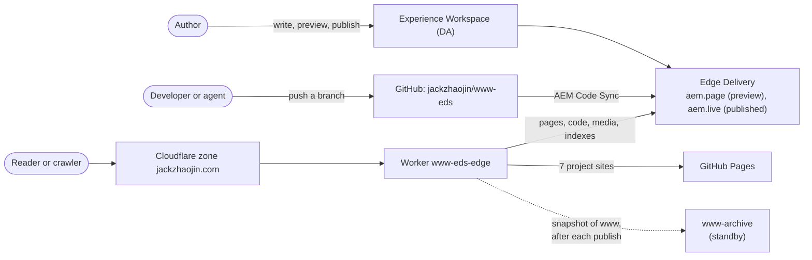
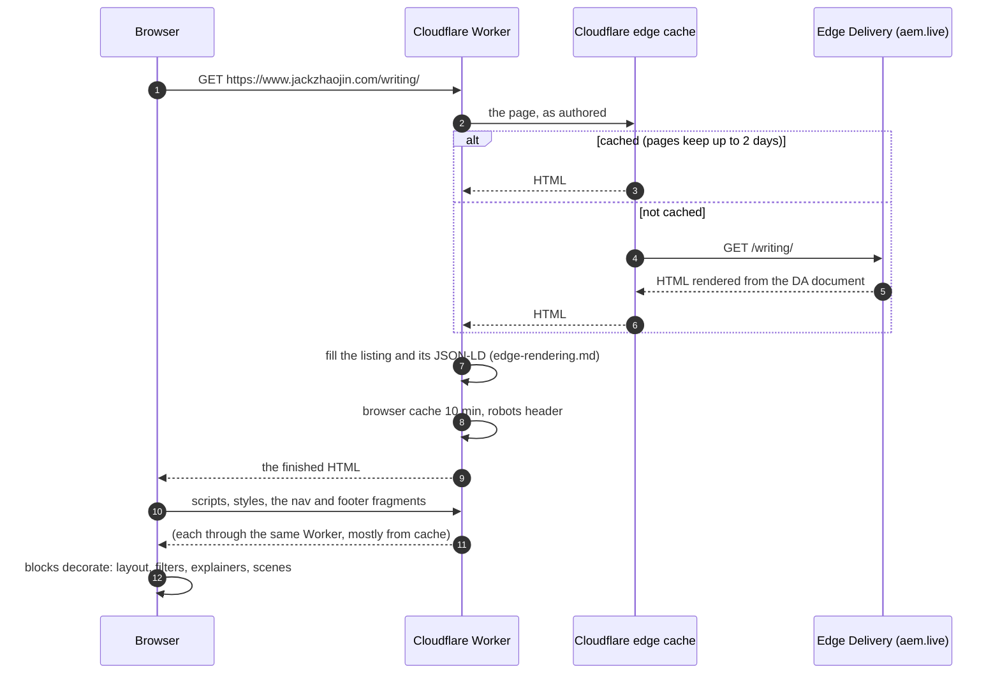
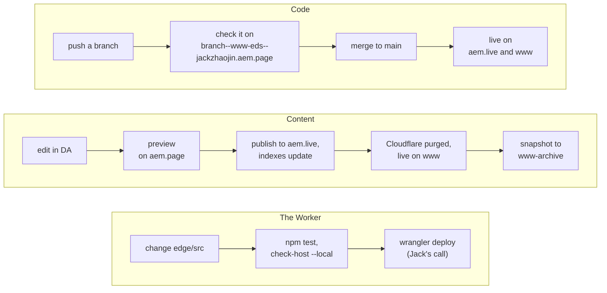

# How the site works

www.jackzhaojin.com is written in Adobe's document editor, served by Adobe Edge Delivery Services (EDS), and fronted by a Cloudflare Worker that finishes some pages on the way out. This page is the whole picture; [cloudflare-worker.md](cloudflare-worker.md) and [edge-rendering.md](edge-rendering.md) zoom in on the Cloudflare part.

## The short version

- **Content** is written in Experience Workspace (DA). Publishing a page puts it on Edge Delivery.
- **Code** (blocks, styles, scripts) lives in this GitHub repo. Edge Delivery serves it straight from the branch, with no build step.
- **Readers** reach www through Cloudflare. A Worker sends each request to the right origin, adds what Edge Delivery can't (listing rows, structured data, cache and robots headers), and hands the page back.

## The pieces

| Piece | What it does | Where it's configured |
|---|---|---|
| Experience Workspace (DA) | the editor and the store for every page, sheet and image | [da.live/#/jackzhaojin/www-eds](https://da.live/#/jackzhaojin/www-eds); rules in [content/README.md](../content/README.md) |
| GitHub repo | the site's code: `blocks/`, `templates/`, `scripts/`, `styles/`, the Worker in `edge/` | this repo |
| Edge Delivery | renders documents into HTML, keeps the query indexes, serves code and media | the Admin API config service, kept as files in [hlx-config/](../hlx-config/README.md) |
| Cloudflare zone and Worker | DNS, the edge cache, and the Worker on `www.jackzhaojin.com/*` | [edge/](../edge/README.md) for the Worker; the route and rules live in the Cloudflare dashboard |
| GitHub Pages | the old site and 7 project sites still served at www's origin | `jackzhaojin.github.io` (its `CNAME` stays www) |
| www-archive | a snapshot of www as served, taken after each publish; the standby if Adobe can't serve the site | [jackzhaojin/www-archive](https://github.com/jackzhaojin/www-archive), at archive.jackzhaojin.com |

## The hosts

| Host | What answers | Search |
|---|---|---|
| www.jackzhaojin.com | the Worker: Edge Delivery for the site, GitHub Pages for the project sites | indexed |
| gh.jackzhaojin.com | the Worker in `github` mode: the old GitHub Pages site, kept for comparison | noindex |
| eds.jackzhaojin.com | a Cloudflare Redirect Rule: 302 to www, path and query kept | |
| archive.jackzhaojin.com | the www-archive Worker | noindex |
| `main--www-eds--jackzhaojin.aem.live` and `.aem.page` | Edge Delivery directly, no Worker | noindex |
| `<branch>--www-eds--jackzhaojin.aem.page` | a branch's code with the previewed content, for checking a change before it merges | noindex |

## One page view, start to finish

The Worker runs on every request, even when the page itself comes from the cache: Cloudflare runs Workers in front of its cache, not behind it. That's what lets it finish a cached page with fresh data.

## Who renders what

A page on www is built in three places. Knowing which one owns a piece is most of debugging it.

| Where | When | What it produces | Whose code |
|---|---|---|---|
| **Edge Delivery** | when a page is previewed or published (then cached) | the HTML from the DA document: sections, each block as nested `
`s, the head from the page metadata (title, description, canonical, Open Graph, any authored JSON-LD) | Adobe's |
| **The Worker** | on every request to www | the rows of a listing page, its JSON-LD graph, a talk or project page's JSON-LD, and the headers (browser cache, robots) | `edge/src/` |
| **The browser** | after the HTML arrives | everything visual: block decoration, the nav and footer, the theme, filters, explainers and scenes, and analytics on www | `scripts/`, `blocks/`, `templates/` |

Edge Delivery can't run site code on its servers: it renders documents, and the site's JavaScript runs in the browser. The Worker is the one place this site runs its own code before the reader gets the HTML. [edge-rendering.md](edge-rendering.md) is about what that buys.

## How a change gets to readers

Code and content ship separately, on purpose.

- **Code:** a branch is live on its own preview host as soon as it's pushed, with the real content. Merging `main` ships it. A change to code the site runs gets a release (a `vX.Y.Z` tag and a `release/X-Y-Z` branch); see the Releases table in the [README](../README.md#releases).
- **Content:** publishing makes a page live on aem.live and updates the indexes it belongs to. Edge Delivery then purges the Cloudflare zone (push invalidation; on the free plan that's the whole zone), so www shows the change right away. A new article shows up on the writing hub without anyone touching the hub ([edge-rendering.md](edge-rendering.md#freshness)). The steps and the rules are in [content/README.md](../content/README.md).
- **The Worker** is the exception: merging `main` doesn't deploy it. A change in `edge/src/` reaches www only through `wrangler deploy`, and every Cloudflare change is Jack's call.

## When something breaks

| If | Then | How |
|---|---|---|
| a listing's index is slow or down | the page goes out as authored and the browser fills the list | automatic ([edge-rendering.md](edge-rendering.md#when-things-go-wrong)) |
| the Worker misbehaves | remove the www route in the Cloudflare dashboard: www goes straight to GitHub Pages, which never stopped serving it | one dashboard step |
| Adobe can't serve the site | redeploy the Worker with `ARCHIVE_ORIGIN` set: www comes from the www-archive snapshot | [edge/README.md](../edge/README.md#if-adobe-cant-serve-the-site) |
