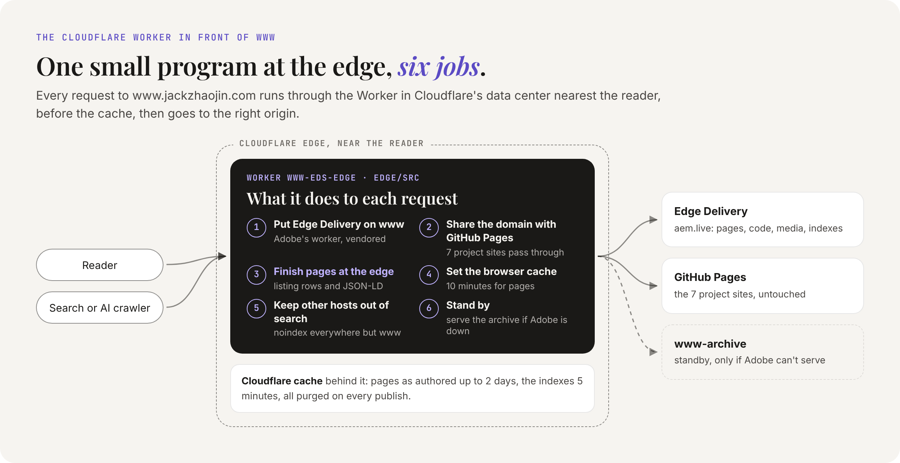
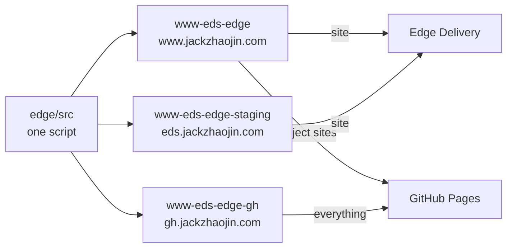
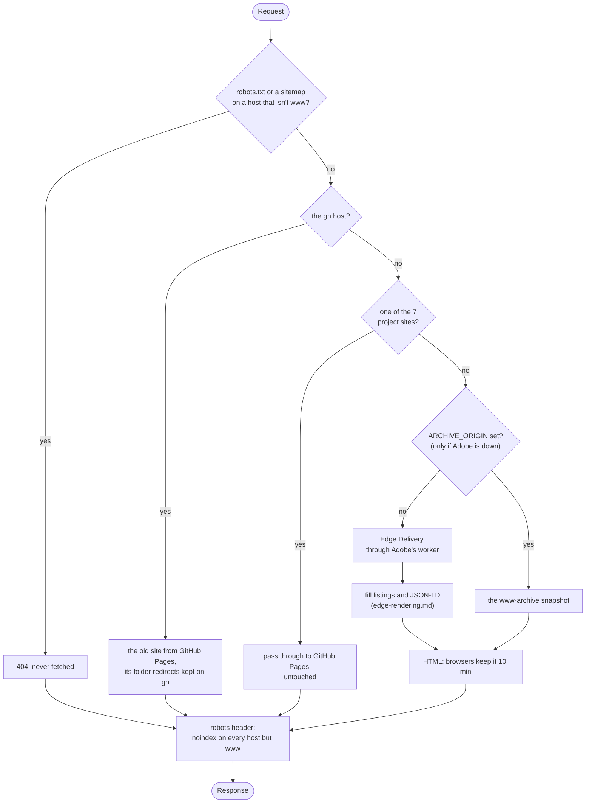
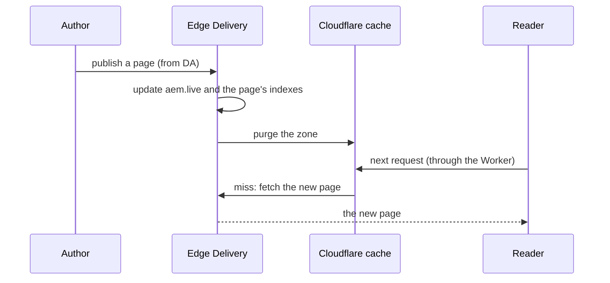

# The Cloudflare Worker

Every request to www.jackzhaojin.com goes through one small program running at Cloudflare's edge: the Worker in [`edge/`](../edge/). It's about 470 lines of JavaScript, a quarter of it Adobe's. This page explains what it does and why; [edge/README.md](../edge/README.md) is the operating manual (commands, versions, deploy history).

## What a Worker is

A Cloudflare Worker is JavaScript that runs in Cloudflare's data centers, near the reader, on every request to the routes it's bound to. It sees the request before Cloudflare's cache does, can fetch from any origin (and use the cache while doing it), and can change the response before it goes back. There's no server to run: Cloudflare starts it on demand, in milliseconds, wherever the reader is.

## Why this site has one

Edge Delivery is happy to sit behind any CDN ("bring your own CDN"). Adobe publishes a ready-made Cloudflare Worker for that. This site needed more than that one job, so the Worker does six:

<picture>
  <source media="(prefers-color-scheme: dark)" srcset="images/worker-jobs-dark.png">
  
</picture>

1. **Put Edge Delivery on www.** Adobe's worker, vendored into `src/aem.mjs`, forwards each request to `main--www-eds--jackzhaojin.aem.live` with the headers Edge Delivery expects.
2. **Share the domain with GitHub Pages.** Seven older project sites (`/adapt-to-2026-demo/`, `/bruce-lava-dash/` and five more) still live on GitHub Pages under www's own origin. The Worker passes those paths through untouched.
3. **Finish pages at the edge.** Listing pages get their rows and structured data before they leave Cloudflare. That's [edge-rendering.md](edge-rendering.md).
4. **Set the browser cache.** Pages stay 10 minutes in a browser, as on GitHub Pages, not Edge Delivery's 2 hours.
5. **Keep everything but www out of search.** Every other host answers `noindex`.
6. **Stand by.** If Adobe can't serve the site, one setting serves www from the [www-archive](https://github.com/jackzhaojin/www-archive) snapshot instead.

## One script, three Workers

`edge/wrangler.toml` deploys the same code three times. Each copy is told what it is by its variables.



| Worker | Host | Variables that matter | Notes |
|---|---|---|---|
| `www-eds-edge` | www | `INDEXABLE = "true"`, `PROJECT_ORIGIN = "passthrough"` | production. Its route was added in the Cloudflare dashboard, not in `wrangler.toml`, so no deploy can move it |
| `www-eds-edge-staging` | eds | `PUSH_INVALIDATION = "disabled"` | gets no traffic since 2026-10-27 (eds 302s to www first); test changes with `check-host.mjs --local staging` instead |
| `www-eds-edge-gh` | gh | `MODE = "github"` | the old GitHub Pages site, read through www's origin, for comparison |

## What happens to a request

The order lives in [`src/index.mjs`](../edge/src/index.mjs), which is short enough to read in one go.



A few details worth knowing:

- **Project sites are checked first** and, on www, passed through with nothing changed, so their paths, query strings and caching stay exactly GitHub's. The list is `PROJECT_SITES` in [`src/routes.mjs`](../edge/src/routes.mjs), and it only matches whole folder names (`/bruce-lava-dash/` but never `/bruce-lava-dash-2/`).
- **Adobe's worker** (`src/aem.mjs`, from `adobe/aem-cloudflare-prod-worker`, changed only to export its handler by name) rewrites the host to aem.live, tells Edge Delivery the public host (`x-forwarded-host`) and that Cloudflare is in front (`x-byo-cdn-type`), turns on push invalidation (`x-push-invalidation`), strips query strings Edge Delivery doesn't use (media keep their image sizes, JSON keeps `limit`, `offset` and `sheet`), answers 404 for `/drafts/`, and asks Cloudflare to cache HTML, which it doesn't by default.
- **The listing step** only touches HTML pages that came back `200`. Code, media, JSON, fragments and errors pass straight through.

## The caches

Three caches sit between an edit and a reader. Each one has an owner and a reason.

| Cache | What it holds | How long | Set by | Emptied by |
|---|---|---|---|---|
| Browser | pages and `.plain.html` fragments | 10 minutes, then it checks back | the Worker (`pageCache`) | time; nothing can purge a browser, which is why it's short |
| Browser | code, media, JSON | the origin's own header (2 hours for code and JSON) | Edge Delivery | time |
| Cloudflare edge | pages as authored, code, media, JSON | up to 2 days (`cdn-cache-control: max-age=172800`) | Edge Delivery | every publish (push invalidation) |
| Cloudflare edge | the indexes the Worker reads for listings | 5 minutes (`INDEX_TTL`) | the Worker | time, or a publish |

The finished page itself is never cached at Cloudflare. The Worker runs in front of the cache, so it rebuilds a listing page on every request from two cached inputs: the page as authored and its index. That costs a little work per request and buys a list that's never older than its index.

**Push invalidation** is how a publish shows up right away. Edge Delivery holds a Cloudflare Cache Purge token in the site's CDN config, so after every publish it purges the zone. On Cloudflare's free plan a purge is the whole zone, which is fine for a site this size.



The record of turning it on is [hlx-config/2026-10-26-push-invalidation/](../hlx-config/2026-10-26-push-invalidation/EXECUTION.md).

## Search engines

Only www may be indexed. The Worker enforces that whatever the origin says.

| Host | Pages | `.plain.html` fragments | `robots.txt` and sitemaps |
|---|---|---|---|
| www | no robots header: indexable | `X-Robots-Tag: noindex, nofollow` | served |
| eds, gh (and any other) | `X-Robots-Tag: noindex, nofollow` | `X-Robots-Tag: noindex, nofollow` | 404 |

Fragments are the nav and footer, page bodies without a head that scripts load into every page. Adobe's own CDN keeps them out of search the same way. Adobe's worker drops Edge Delivery's own robots header (aem.live is always noindex), so the Worker sets it again per host.

## Safety nets

| What fails | What happens | Who acts |
|---|---|---|
| a listing's index errors or takes over 3 seconds | the page goes out as authored, and the browser fills the list | nobody: automatic |
| the Worker itself | remove the `www.jackzhaojin.com/*` route in the Cloudflare dashboard; www goes straight to GitHub Pages | Jack |
| Edge Delivery | deploy with `--var ARCHIVE_ORIGIN:https://www-archive.jackzhaojin.workers.dev`; www comes from the snapshot, project sites still pass through | Jack ([edge/README.md](../edge/README.md#if-adobe-cant-serve-the-site)) |

## The code

| File | What it does |
|---|---|
| [`src/index.mjs`](../edge/src/index.mjs) | the request order above, in about a dozen lines |
| [`src/routes.mjs`](../edge/src/routes.mjs) | project sites, GitHub and archive fetches, the crawler 404s, the browser cache, the robots header |
| [`src/listings.mjs`](../edge/src/listings.mjs) | edge rendering: listing rows, listing JSON-LD, project page JSON-LD |
| [`src/aem.mjs`](../edge/src/aem.mjs) | Adobe's worker, vendored |
| [`wrangler.toml`](../edge/wrangler.toml) | the three Workers and their variables |
| [`test/worker.test.mjs`](../edge/test/worker.test.mjs) | 22 tests, run in plain Node with `fetch` stubbed |
| [`scripts/check-host.mjs`](../edge/scripts/check-host.mjs) | checks a host end to end: every sitemap page, the project sites, the root files, the 404s, the redirects, the robots header |
| [`scripts/preview-listing.mjs`](../edge/scripts/preview-listing.mjs) | runs the edge render on your machine over a preview host, so you can see a hub as www will serve it |

`src/listings.mjs` imports the browser's own modules from `scripts/` (the row and JSON-LD builders), so the Worker and the browser can't drift apart. Wrangler bundles them at deploy time.

## Testing and deploying

```bash
cd edge && npm test
```

```bash
node edge/scripts/check-host.mjs --local www
```

`--local` runs the Worker in your Node process with that environment's variables, against the real origins: the same code path as Cloudflare, without deploying anything. Use `--local staging` for a change before it goes to www.

```bash
cd edge && npx wrangler deploy --env="" --dry-run --outdir /tmp/worker-dry-run
```

A dry run shows what a deploy would carry and deploys nothing. Real deploys (`npx wrangler deploy --env=""`, `--env staging`, `--env gh`) are Cloudflare changes, and every Cloudflare change is Jack's call. Merging `main` doesn't deploy the Worker.
