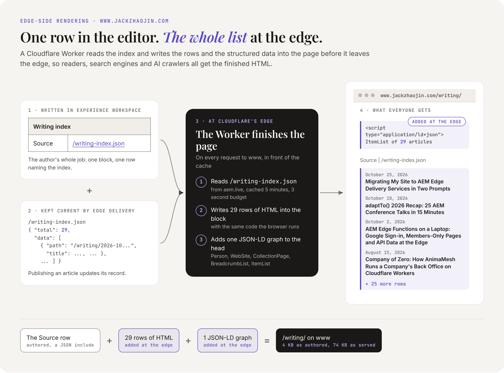
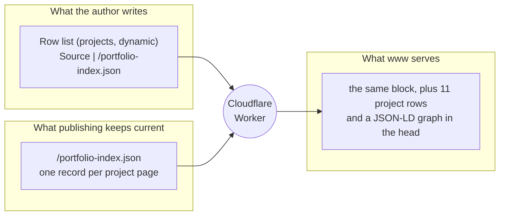
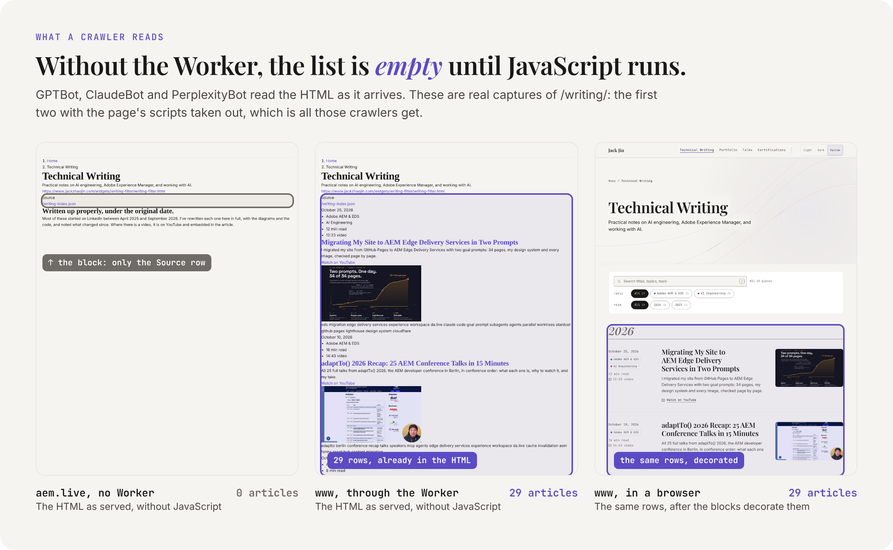
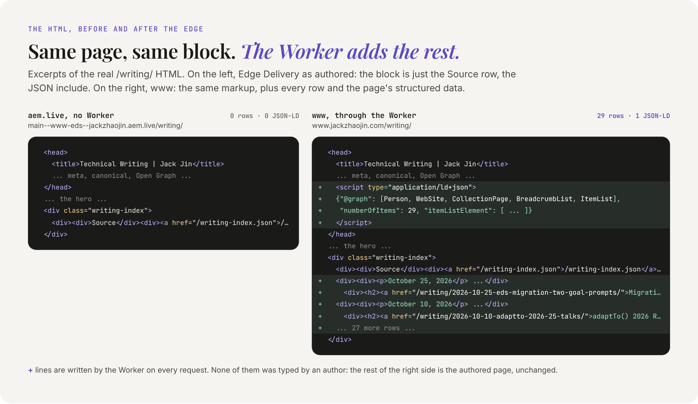
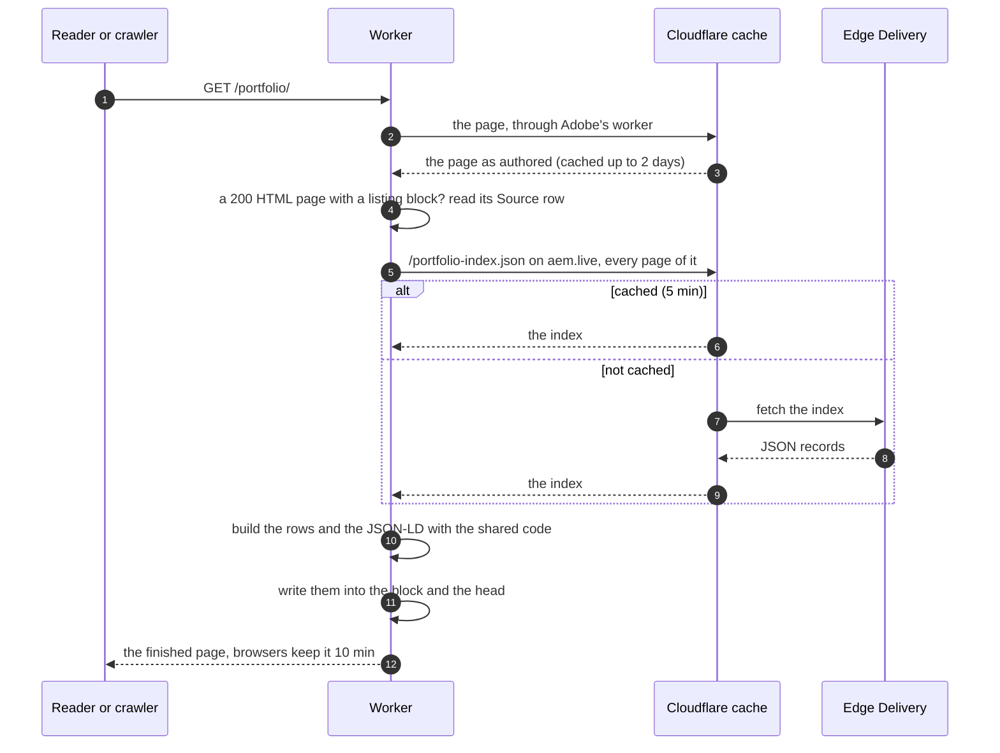
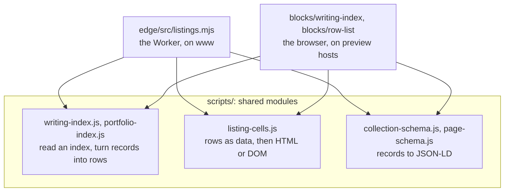
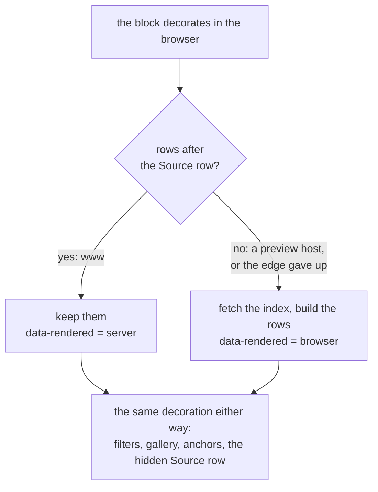
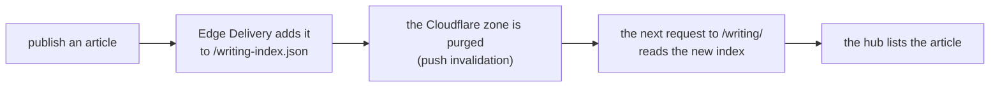
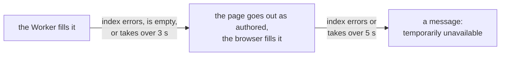

# Edge-side rendering

The writing and portfolio hubs on www list every article and project (40 rows between them today), and nobody types those lists. Each hub is authored as one block with a single row that names an index. On the way out of Cloudflare, the Worker reads that index and writes the full list, and the structured data that describes it, into the HTML. Readers, search engines and AI crawlers all get the finished page in the first response.

<picture>
  <source media="(prefers-color-scheme: dark)" srcset="images/edge-hero-dark.png">
  
</picture>

This page explains the idea, shows it working on the live site, and walks through the code. The Worker as a whole is in [cloudflare-worker.md](cloudflare-worker.md).

The talks hub was a generated list too, until v1.3.0 (2026-10-30). Talks have no pages since then, so there is no index to read: `/talks/` is authored, row by row, and the browser writes its JSON-LD from those rows ([content/README.md](../content/README.md#listing-pages-authored-once-generated-from-the-index), "Talks"). Its rows are in the HTML as it arrives, so crawlers see them without the Worker.

## The idea



- The **author** writes the hub once: a hero, the listing block with its `Source` row, and the page metadata.
- **Edge Delivery** keeps the index current: publishing a project page adds or updates its record in `/portfolio-index.json`.
- The **Worker** joins the two on every request. Publish a new project and the hub lists it, without anyone opening the hub.

## Why at the edge

A list built by JavaScript in the browser is invisible to anything that doesn't run JavaScript. When the hubs were first rebuilt as generated lists (as drafts, on 2026-10-26), the served HTML of the writing draft had 0 article links, against 29 on www. Google runs JavaScript, but most AI crawlers and agents (GPTBot, ClaudeBot, PerplexityBot) read the HTML as it arrives. The switch would have emptied both hubs for them.

<picture>
  <source media="(prefers-color-scheme: dark)" srcset="images/edge-crawler-view-dark.png">
  
</picture>

The first two captures are the HTML exactly as each host serves it, with the page's scripts taken out: that's all a crawler that doesn't run JavaScript has to read.

Jack's requirements for the fix: no manual data entry, JSON-LD "code-generated, not authored", and an authoring experience worth demoing. Asked where the code should render: "Edge Worker". The options looked like this:

| Where the list is built | Crawlers that don't run JavaScript | Author's work | |
|---|---|---|---|
| typed by the author into the hub | see it | every new item means editing the hub and its JSON-LD by hand, and the two drift | how the hubs worked until v1.1.1 |
| by the browser only | see an empty block | none | what preview hosts still do |
| by Edge Delivery's servers | would see it | none | not possible: Edge Delivery renders documents and runs no site code |
| **by the Cloudflare Worker** | **see the whole list and its JSON-LD** | **none** | **what www does since v1.1.1** |

The full record of that decision is in [ai-docs/2026-10-26-writing-index/](../ai-docs/2026-10-26-writing-index/README.md#edge-rendering-and-generated-json-ld-claudes-review-2026-10-26).

## See it yourself

The same page from Edge Delivery directly (no Worker) and from www (through the Worker):

```bash
for host in main--www-eds--jackzhaojin.aem.live www.jackzhaojin.com; do
  curl -s "https://$host/writing/" | grep -o 'href="/writing/20[^"]*"' | sort -u | wc -l
done
```

Measured on 2026-10-30:

| Page | aem.live, as authored | www, rendered at the edge |
|---|---|---|
| `/writing/` | 0 article links, no JSON-LD | 29 article links, one JSON-LD graph with an ItemList of 29 |
| `/portfolio/` | the gallery block empty, no JSON-LD, 12 KB | 11 project cards, one JSON-LD graph with an ItemList of 11, 24 KB |
| `/portfolio/content-factory/` | the Related list empty, no JSON-LD | the articles that link to the project, and a graph with the WebPage, its breadcrumb and the project as SoftwareSourceCode |
| `/talks/` (since v1.3.0) | 9 authored talk rows, no JSON-LD | the same page, untouched by the Worker; the browser adds a graph with an Event per talk |

In a browser, open the hub, then the developer console:

```js
document.querySelector('.writing-index').dataset.rendered
```

It says `server` on www (the Worker filled it) and `browser` on aem.page (the browser did).

### Before and after

The writing hub's real HTML, side by side. Every `+` line is written by the Worker on each request:

<picture>
  <source media="(prefers-color-scheme: dark)" srcset="images/edge-html-dark.png">
  
</picture>

The same thing in text, for the portfolio hub's block.

What Edge Delivery serves for the portfolio hub's block, exactly as authored:

```html
<div class="row-list projects dynamic">
  <div>
    <div>Source</div>
    <div><a href="/portfolio-index.json">/portfolio-index.json</a></div>
  </div>
</div>
```

What www serves (one of the 11 rows shown, shortened):

```html
<div class="row-list projects dynamic">
  <div>
    <div>Source</div>
    <div><a href="/portfolio-index.json">/portfolio-index.json</a></div>
  </div>
  <div><div><p>2026</p><p>ad hoc</p></div><div><h2 id="anima-mesh"><a href="/portfolio/anima-mesh/">Anima Mesh</a></h2><p>The company-of-0 experiment</p>...</div><div><p>ch-anima p-anima-arch ...</p></div></div>
  ...
</div>
```

And in the head, one graph: `Person`, `WebSite`, `CollectionPage`, `BreadcrumbList` and an `ItemList` of the rows.

The generated rows are the same cells an author would have typed. The block's own JavaScript then decorates them exactly like authored rows, so nothing downstream knows the difference.

## How it works



The code is `renderListings` in [`edge/src/listings.mjs`](../edge/src/listings.mjs). In order:

1. **Only pages.** It acts on a `GET` that came back `200` as HTML, on a path ending in `/` or a name without a dot. Code, media, JSON, `.plain.html` fragments and the Markdown copies (`index.md`) pass through untouched.
2. **Find the listing.** It looks for one of three exact opening tags (the table below). A page without one goes out as it came.
3. **Read the Source row.** The first link in the block names the index, and it has to end in `.json`.
4. **Load the index from aem.live,** not from www: a Worker's fetch to its own zone's hostname reaches the zone's origin, which is GitHub Pages. It reads every page of the index (200 records a page), gives the whole load 3 seconds, and lets Cloudflare cache it for 5 minutes (`INDEX_TTL`).
5. **Build the rows** with the same functions the browser uses, and write them into the block right after the Source row.
6. **Build the JSON-LD** (`collectionGraph`): the Person, the WebSite, the CollectionPage, its BreadcrumbList and an ItemList of the visible rows. Any authored CollectionPage graph is dropped, so the page has exactly one, and the new graph goes in before `</head>`. A Related list gets no graph of its own.
7. **Project pages** (`renderPageSchemaHTML`): a page whose head carries `project-order` metadata and no JSON-LD of its own gets a graph built from its head and links (`scripts/page-schema.js`): the WebPage, its BreadcrumbList, and a SoftwareSourceCode or CreativeWork for the project.
8. **Fix the headers.** The body changed, so `content-length` goes, and on a filled page so do `etag` and `last-modified`, which described the authored page and would let a browser keep an old list. Then the usual 10-minute browser cache applies.

## The three listings

| Block, as written in DA | Class the Worker looks for | Index | Rows | JSON-LD | Used on |
|---|---|---|---|---|---|
| Writing index | `writing-index` | `/writing-index.json` | one card per article: date, topics, title, summary, cover | CollectionPage and ItemList | `/writing/` |
| Row list (projects, dynamic) | `row-list projects dynamic` | `/portfolio-index.json` | one gallery card per project | CollectionPage and ItemList | `/portfolio/` |
| Row list (related, dynamic) | `row-list related dynamic` | `/writing-index.json` | the articles that link to this page, newest first | none: the page's own graph describes it | project pages |

How to author them, and what each index reads from a page, is in [content/README.md](../content/README.md#listing-pages-authored-once-generated-from-the-index).

## One generator, two places

The Worker doesn't have its own copy of the listing logic. It imports the browser's modules from `scripts/`, and Wrangler bundles them in at deploy time.



Rows are built as data first (a row is a list of cells, a cell a list of nodes). `rowsToHTML` turns them into markup for the Worker, `rowsToDOM` into elements for the browser. So the HTML a crawler reads and the page a person sees come from one implementation and can't disagree.

When the block runs in the browser, it checks whether the edge already did the work (`fillFromIndex` in `scripts/query-index.js`):



The Source row stays in the page, hidden, so Experience Workspace can still edit it.

| Where you look | Who fills the list |
|---|---|
| www.jackzhaojin.com | the Worker |
| `*.aem.page`, `*.aem.live`, a branch's preview host | the browser |
| `localhost:3000` (`aem up`) | the browser |
| `localhost:8788` (`node edge/scripts/preview-listing.mjs`) | the Worker's render, run on your machine over aem.page |
| archive.jackzhaojin.com | nobody: the snapshot was taken from www, already filled |

## Freshness



The hub is never republished for this. If the purge doesn't reach the cached index, it expires on its own within 5 minutes. Unpublishing a page takes it out of its index, and so out of the list (while the index's definition still covers that path: [content/README.md](../content/README.md#listing-pages-authored-once-generated-from-the-index)).

## When things go wrong

The edge render is an improvement layered on a page that already works without it.



- Any error while filling a listing is caught and logged (`listing on /portfolio/ left to the browser: ...`), and the block goes out as authored. A hub then keeps the origin's validators (`etag`, `last-modified`), since its body is the origin's.
- People still see the list, a moment later. Crawlers that don't run JavaScript see an empty block until the index is back.
- If the Worker itself is removed (the rollback), www goes to GitHub Pages, and none of this applies.

## Limits worth knowing

- **Exact class match.** The Worker looks for the block's exact opening tag. Write the variants in the order shown (`Row list (projects, dynamic)`, not `(dynamic, projects)`), and if a dynamic block ever gets another variant, add its class string to `LISTINGS` too. Otherwise the browser still fills it, but crawlers get an empty block.
- **One listing per page.** The Worker fills one listing block per page. A second dynamic listing on the same page would be filled by the browser only.
- **The Markdown copy isn't rendered.** `<path>index.md` shows the Source row, not the list.
- **Text, not a DOM.** The Worker reads the page into memory and edits it as text with a few patterns. Pages are small (the portfolio hub is 12 KB as authored, 24 KB filled), and it keeps the render a pure function that runs in plain Node, which is how the tests and `preview-listing.mjs` run it. The cost: if Edge Delivery ever changed how it writes a block's opening tag, the edge render would quietly hand over to the browser. The `curl` check above catches that.
- **Rebuilt per request.** The finished page isn't cached; its two inputs are. Building the rows is quick next to the network.

## Changing it

To add a new dynamic listing:

1. **An index.** Add its definition to [`hlx-config/query.yaml`](../hlx-config/query.yaml) (an Admin API change, Jack's call), and publish the pages it should hold.
2. **A module in `scripts/`** that loads the index and turns records into rows and JSON-LD items. `scripts/portfolio-index.js` is the smallest example.
3. **The browser side.** An entry in `DYNAMIC` in `blocks/row-list/row-list.js`, or a block of its own that calls `fillFromIndex`.
4. **The edge side.** An entry in `LISTINGS` in `edge/src/listings.mjs`, with the block's exact opening tag.
5. **A test** in `edge/test/worker.test.mjs`, then `cd edge && npm test`.
6. **Look at it as www will serve it:**

   ```bash
   node edge/scripts/preview-listing.mjs
   ```

   Open `http://localhost:8788/<hub path>` and view the source: the rows are in the block and the graph is in the head. The `x-listing` response header says `filled` or `untouched`.
7. **Ship it.** The code change is a release, and the Worker goes out with `wrangler deploy` (Jack's call). Only then publish the hub with just its Source row: until the Worker knows the block, crawlers on www would get it empty.

## Further reading

- [edge/README.md](../edge/README.md#a-request-in-order-srcindexmjs), step 6: the operating notes
- [content/README.md](../content/README.md#listing-pages-authored-once-generated-from-the-index): how to author listing pages and Related lists
- [ai-docs/2026-10-26-writing-index/](../ai-docs/2026-10-26-writing-index/README.md): why it renders at the edge
- [ai-docs/2026-10-26-pages-indexes-library/](../ai-docs/2026-10-26-pages-indexes-library/README.md): v1.1.1, one page per talk and project and the hubs switched over
- [ai-docs/2026-10-30-talks-into-portfolio/](../ai-docs/2026-10-30-talks-into-portfolio/README.md): v1.3.0, the talk pages retired and the talks hub authored
