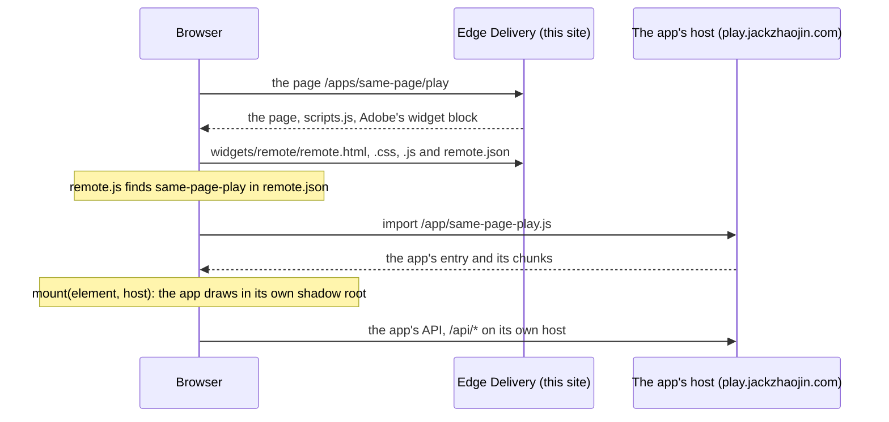

# The remote widget: apps on the site's pages

Since v1.8.0 a page on the site can run an app that is built and deployed somewhere else, with one link. The first two are Same Page's phone app and big screen, Jack's AEM Rockstar 2027 demo: hundreds of people at Adobe Summit open `play.jackzhaojin.com` on their phones and write one page together while `show.jackzhaojin.com` runs on the big screen. Both are pages of this site, authored in Experience Workspace like any other, and the app inside each comes from the demo's own repo, [jackzhaojin/eds-multiplayer-authoring](https://github.com/jackzhaojin/eds-multiplayer-authoring).

## What the author does

The author pastes one link, alone in a paragraph, the way Adobe's [widgets](https://www.aem.live/docs/widgets) are placed:

```
/widgets/remote/remote.html?app=same-page-play
```

The page's metadata does the rest: `template | app` (the app fills the screen, no header or footer), `theme | adobe` and `robots | noindex, nofollow`. The query string is the widget's settings, the native widget way: `app` names the app, and the app may read the few other parameters its registry entry allows (`theme`, for one). Authors name an app, never an address of code.

## What happens on the page



1. Adobe's widget block (`blocks/widget/`, unchanged from the boilerplate) turns the link into a widget, loads `widgets/remote/remote.html` (the placeholder), `remote.css` and `remote.js`, and turns the query string into `data-` attributes.
2. `remote.js` looks the name up in `widgets/remote/remote.json`, the registry. An unknown name stops here, with a note on the page: no script runs.
3. It imports the app's entry module from the address in the registry, and calls its `mount(element, host)` once Edge Delivery shows the widget's section (a section stays hidden until its blocks have loaded, and an app in a hidden section could neither take focus nor measure itself; since v1.8.1). The page does not wait: the placeholder shows at once, says "Still loading" after 8 seconds, and if the app fails it says so and links to the app on its own host. The rest of the page keeps working.
4. The app draws inside a shadow root of its own, so its styles and the site's never meet, and calls its API on its own host.

## The registry

`widgets/remote/remote.json` is code: it changes only by a commit to this repo, reviewed like any other. Each app has an entry:

| Field | What it is |
|---|---|
| `entry` | the app's entry module, https only |
| `local` | the app's local build, used only when the page itself is on this machine |
| `fallback` | the app on its own host, linked from the failed note |
| `params` | the query parameters the app may read; the others never reach it |
| `layout` | `screen` for an app that fills the screen, else a block in the page |
| `description` | what the app is, and where its code lives |

## Why it is built this way

- **Adobe's widget pattern, untouched.** The remote widget is an ordinary widget. Adobe's files stay identical to the boilerplate.
- **Content, page code and application code each live where they belong.** The page is content in Experience Workspace. The widget is page code in this repo. The app is in its own repo, with its own tests and deploys: a change to the app ships without a commit here.
- **Governance.** An app runs on the site only if a reviewed commit registered it, and only with the parameters it declares. The site's content security policy is unchanged: it already lets a trusted script import a module, and its Trusted Types policy already lets an app set its markup.
- **Monitoring.** The widget reports a `remote` checkpoint when an app is mounted and an `error` one when it fails, both with the app's name, through the site's own real-user monitoring.

## The app pages

The pages live under `/apps/`, one folder per app: `/apps/same-page/play` and `/apps/same-page/show`. They are noindex, and the query index leaves `/apps/**` out (`hlx-config/2026-11-19-apps-index/`), so they never reach the listings or the sitemap.

Each app's own address shows the same page: the app's Cloudflare Worker serves this site's page at its root and passes the site's code through from Edge Delivery, so phones open `play.jackzhaojin.com` and get this page with the app in it, calling its API on the same origin. If Edge Delivery cannot answer, that address falls back to the app by itself, at `/app/`. That Worker is the app's, deployed from the demo's repo; this site's Worker is not involved.

## The contract with an app

An app exports `mount(element, host)`, where `host` is `{ version: 1, name, entry, params, rum }`, and resolves to a function that unmounts it. The app side, a helper that builds the shadow root and its context, lives in the demo's repo as `packages/remote-app`, with a stand-in for this site that its tests run against: it copies `aem.js`, Adobe's widget block, this widget and the app template from here and fails when they drift.
