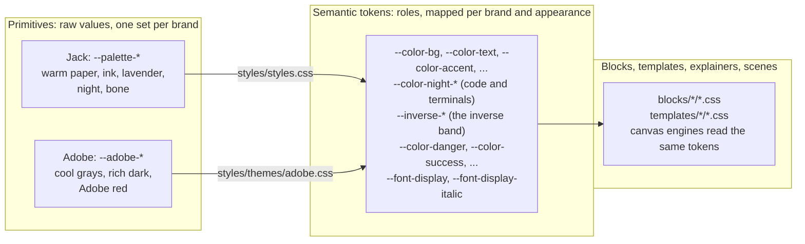
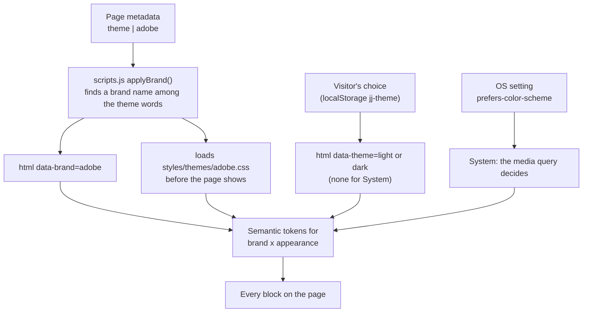

# Theming: brands and appearances

Every page on the site can take either of two brands, in either appearance, and every block follows. The brand is Jack's (the default, design system v3) or Adobe's (an Adobe-inspired brand, since v1.4.0). The appearance is light or dark: the visitor's Light, Dark or System choice in the header. The two are separate. A page's author picks the brand, and the visitor picks the appearance.

## Three tiers of tokens

The design system is CSS custom properties in three tiers. Blocks only ever read the middle one.

- **Primitives** are raw values with no meaning: `--palette-lavender-600` is a color, not "the accent". Each brand has its own set.
- **Semantic tokens** name a role: `--color-accent`, `--color-night-bg` (the ground under code), `--inverse-text` (text in an inverse band), `--color-danger` (a failed check). `styles/styles.css` maps them onto Jack's primitives for light, for dark, and for System when the OS is dark. `styles/themes/adobe.css` maps the same tokens onto Adobe's primitives, for the same three cases.
- **Blocks** read semantic tokens only. A block that reads a primitive would keep Jack's color on an Adobe page, so a unit test fails the build when one does (below).

A few colors are deliberately the same in every brand and stay as they are: status tones (danger, success, warning), the categorical topic and project colors on the portfolio, masks, black shadows, and the mock-ups of other products' interfaces inside two explainers (`content-contract`, `theme-swap`).

## How a page gets its look

- **Brand, per page:** add `theme | adobe` to the page's metadata block (page properties in Experience Workspace). It can sit beside other theme words, such as `theme | code-nowrap, adobe`. EDS turns the metadata into `<meta name="theme">`; `applyBrand()` in `scripts/scripts.js` sets `data-brand` on `<html>` and loads the brand's stylesheet, and the body stays hidden until it has loaded, so the page never shows in the wrong brand. Pages without it load nothing extra.
- **Brand, for a folder or the whole site:** the bulk metadata sheet (`metadata` in DA, `hlx-config/metadata.tsv` here) takes a `theme` column with a URL pattern, such as `/drafts/**`. A page's own metadata wins over the sheet. Changing the sheet is a site config change, so it's Jack's call.
- **Appearance:** unchanged by the brand. The header's Light, Dark and System control sets `data-theme` (or removes it for System), stored in `jj-theme`. A brand never writes the visitor's choice.
- **A section that forces its own appearance** (section metadata `theme | dark`, as inverse bands do) gets the brand's tokens for that appearance too: each brand's rules also match `[data-theme]` on a section inside the page.

## Which rule wins

| Situation | Rule | Specificity |
|---|---|---|
| Jack, light | `:root, [data-theme="light"]` | 0,1,0 |
| Jack, dark (chosen) | `[data-theme="dark"]` | 0,1,0 |
| Jack, dark (System) | `:root:not([data-theme="light"]):not([data-theme="dark"])` in the media query | 0,3,0 |
| Adobe, light | `:root[data-brand="adobe"]`, `[data-brand="adobe"] [data-theme="light"]` | 0,2,0 |
| Adobe, dark (chosen or a forced section) | `:root[data-brand="adobe"][data-theme="dark"]`, `[data-brand="adobe"] [data-theme="dark"]` | 0,3,0 / 0,2,0 |
| Adobe, dark (System) | `:root[data-brand="adobe"]:not([data-theme="light"]):not([data-theme="dark"])` in the media query | 0,4,0 |

Each brand rule outranks the Jack rule for the same case by specificity, not by which stylesheet loaded last.

## The Adobe brand

Cool grays and white on light, near-black grounds with warm white type on dark, one Adobe red accent (a deeper step for text on light, lighter steps on dark, `#eb1000` as the fill behind white type). Inter takes the display role, upright, since the site serves no Inter italic; the accent color carries display emphasis instead. Buttons are pills. Sizes, spacing, layout and the mono labels are v3's. It is inspired by Adobe's look, not Adobe's design system, and uses only the site's own self-hosted fonts.

Every text pair passes WCAG AA, checked by script: on the light page text 16.2:1, muted 8.4, faint 5.1, accent 5.2; on the dark page 16.8, 10.9, 6.5 and 6.1; code text 15.3, comments 5.3, keywords 7.5; white on the red fill 4.6. Code line numbers stay decorative (2.5:1), as in Jack's brand.

## Adding a brand

1. Write `styles/themes/<name>.css`: the brand's primitives (`--<name>-*`), then the semantic tokens for light, dark and System dark, with the selectors above (`data-brand="<name>"`). Copy the shape of `adobe.css`.
2. Add the name to `BRANDS` in `scripts/scripts.js`.
3. Extend `test/theme-contract.test.mjs` to read the new file, and run the tests.
4. Run the theme matrix (below) on every example page, in the new brand, and look at the renders.

## Checking it

- **Unit test** (`node --test test/*.test.mjs`): `test/theme-contract.test.mjs` fails if a brand leaves a semantic token unmapped in any appearance, if Jack's appearances disagree, or if any block, template or shared style reads a primitive.
- **Theme matrix** (`stardust/scripts/deploy/theme-matrix.mjs`): renders pages in each brand and appearance at 1440 and 360 on a local server (`aem-up-local`), stitched viewport by viewport. It reports console errors, horizontal overflow, the brand each page took, text below WCAG AA (`--contrast`), and on Adobe renders any element still showing one of Jack's own colors or Playfair (a leak). With `--against <server>` it pixel-diffs against other code on the same content, the check that a token change leaves Jack's brand untouched. `content/README.md`, section 4, has the commands.

The first full run (2026-10-31, the v1.4.0 work) is in [the build record](../ai-docs/2026-10-31-brand-themes/README.md).
